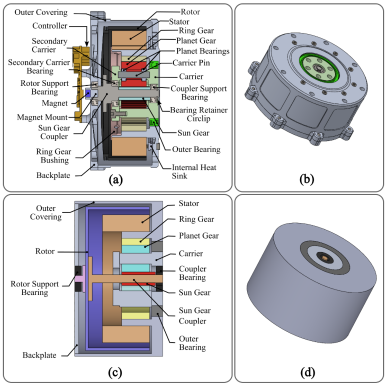
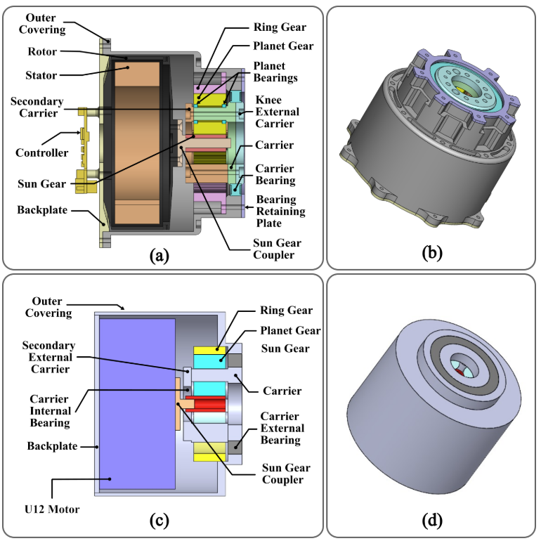
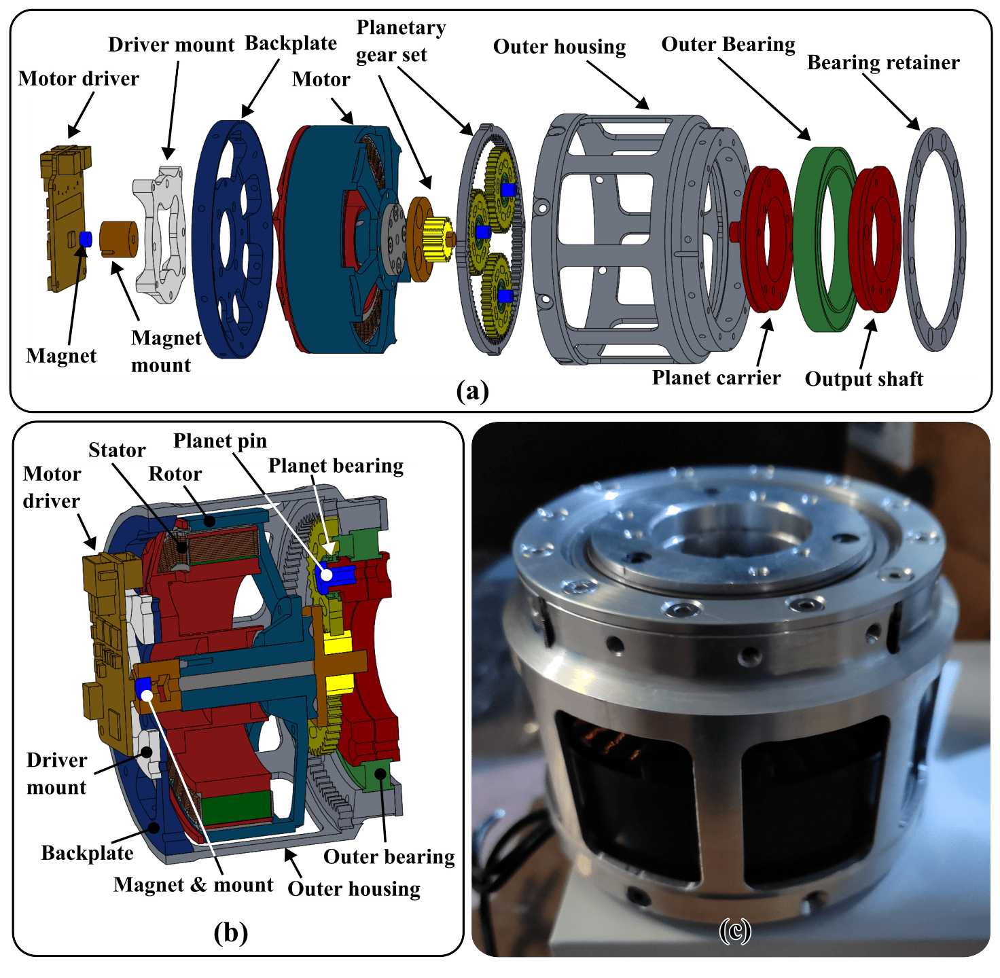
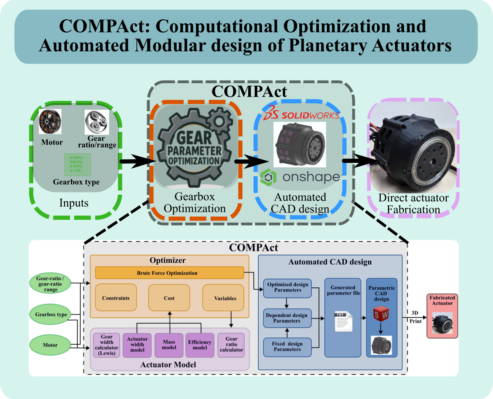
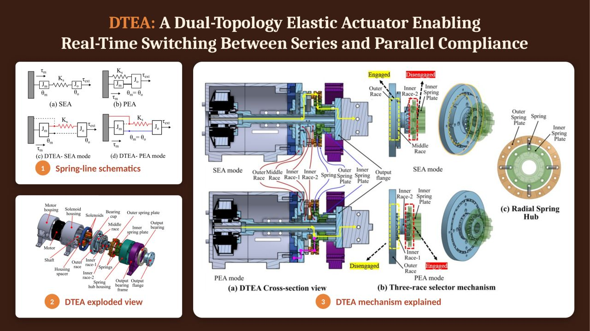
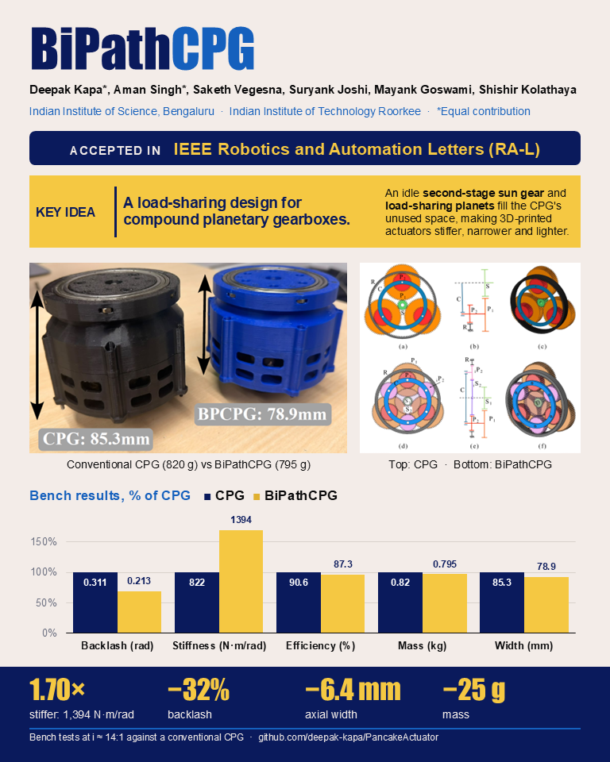

 

### Introduction

Legged robots need actuators that deliver high torque and efficiency while staying light and responsive. Most actuators today are designed by heuristics or intuition, and optimization-based methods often use simplified models of mass and efficiency or skip the choice of gearbox architecture altogether. We develop optimization frameworks that, given a motor and joint-level requirements, choose the gearbox type and its parameters using realistic mass and efficiency models, and then automatically generate manufacturable CAD. We also develop new actuator architectures, such as load-sharing gearboxes and elastic actuators with switchable compliance.

 

### Comparison between External and Internal Single-Stage Planetary Gearbox Actuators

We built a design framework that selects actuator parameters for quasi-direct-drive legged-robot actuators and used it to compare internal (ISSPG) and external (ESSPG) single-stage planetary gearboxes. For the T-motor U12, the ISSPG is lighter for gear ratios from 5:1 to 7:1 and becomes infeasible above 7:1, while the ESSPG is the better choice from 7:1 to 11:1. The framework also generates a template CAD model automatically. We built an ISSPG actuator at 6:1 and an ESSPG actuator at 7.2:1, and their measured masses closely matched the model's predictions. Published at Advances in Robotics (AIR) 2025. [Paper](https://dl.acm.org/doi/10.1145/3787370.3787403) · [arXiv](https://arxiv.org/abs/2506.16356)

  <figure class="act-fig">
    
    <figcaption>ISSPG actuator, 6:1</figcaption>
  </figure>
  <figure class="act-fig">
    
    <figcaption>ESSPG actuator, 7.2:1</figcaption>
  </figure>

 

### Quasi-Direct-Drive Actuator for a Chain-Driven, Sandwich-Legged Quadruped

We designed the quasi-direct-drive (QDD) actuator that powers the joints of our chain-driven, sandwich-legged quadruped. A U10+ outer-rotor BLDC motor drives a single-stage planetary gear set with a 6:1 reduction, and the planet carrier connects to the output shaft, which is supported by a large outer bearing held in place by a bearing retainer. The motor driver sits on the backplate directly behind the motor, and a magnet on the motor shaft lets the driver measure rotor position. All of these parts are enclosed in a single outer housing, which keeps the actuator compact and self-contained. Published at Advances in Robotics (AIR) 2025. [Paper](https://arxiv.org/abs/2503.14255) · [Robot](/projects/RobotPlatforms.html)

<figure class="act-fig" style="max-width: 630px;">
  
  <figcaption>(a) Exploded view, (b) cross-section, and (c) the fabricated actuator.</figcaption>
</figure>

 

### COMPAct: Computational Optimization and Automated Modular Design of Planetary Actuators

COMPAct extends the framework to four gearbox architectures: single-stage planetary (SSPG), compound planetary (CPG), Wolfrom planetary (WPG), and double-stage planetary (DSPG). For a given motor, it finds gearbox parameters that minimize actuator mass and width while maximizing efficiency, and automatically generates CAD that can be 3D printed directly. We fabricated and tested SSPG and CPG actuators: the SSPG actuator reached 60–80% mechanical efficiency, 0.59° no-load backlash, and 242.7 Nm/rad transmission stiffness; the CPG actuator reached 60% efficiency, 2.6° backlash, and 201.6 Nm/rad stiffness. [Paper](https://arxiv.org/abs/2510.07197)

<figure class="act-fig" style="max-width: 760px;">
  
  <figcaption>COMPAct overview: from motor, gear ratio, and gearbox type to optimized parameters, automated CAD, and a 3D-printed actuator.</figcaption>
</figure>

 

### DTEA: A Dual-Topology Elastic Actuator

DTEA is an elastic actuator that can switch between series elastic (SEA) and parallel elastic (PEA) topologies in real time, while it is running. The proof-of-concept prototype completed 324 switching cycles under load without damage, with a switching time under 33.33 ms. In PEA mode it is 1.53× stiffer than in SEA mode (8.54 vs. 5.57 Nm/rad). In disturbance-rejection tests, SEA mode deflects 2.26× more (5.2° vs. 2.3°) and takes 3.45× longer to settle (1380 ms vs. 400 ms), matching the expected behavior of each topology. Accepted to IEEE/RSJ IROS 2026. [Paper](https://arxiv.org/abs/2604.15865)

<figure class="act-fig" style="max-width: 960px;">
  
  <figcaption>DTEA overview: spring-line schematics, exploded view, and the selector mechanism that switches between SEA and PEA modes.</figcaption>
</figure>

 

### BiPathCPG: A Load-Sharing Design Architecture for Compound Planetary Gearboxes

Conventional compound planetary gearboxes add width and mass, and 3D-printed versions lose torsional stiffness. BiPathCPG adds an idle second-stage sun gear and load-sharing second-stage planets in the unused space of a conventional CPG, together with an optimization framework that selects its parameters for a given motor and target gear ratio. Compared with a conventional 3D-printed CPG actuator on custom test rigs, the BiPathCPG prototype has 1.70× the torsional stiffness (1394 Nm/rad), 32% less backlash, 25 g less mass, and about 6.4 mm less axial width, with a peak stall torque of 36.49 Nm. Accepted to IEEE Robotics and Automation Letters (RA-L). [Paper](https://arxiv.org/abs/2611.24142) · [Project page](https://deepak-kapa.github.io/PancakeActuator/)

<figure class="act-fig" style="max-width: 500px;">
  
  <figcaption>BiPathCPG overview: prototype comparison with a conventional CPG, gear layouts, and bench results.</figcaption>
</figure>

 
 

### Future Work

- We aim to extend this research to cycloidal and strain-wave gearboxes for broader actuator optimization applicability.
- We plan to optimize actuator-to-joint transmission systems, investigating belts, chains, and linkages with detailed mass and efficiency models.
- We aim to integrate actuator optimization into system-level co-design for legged robots like monopeds, bipeds, and quadrupeds.
