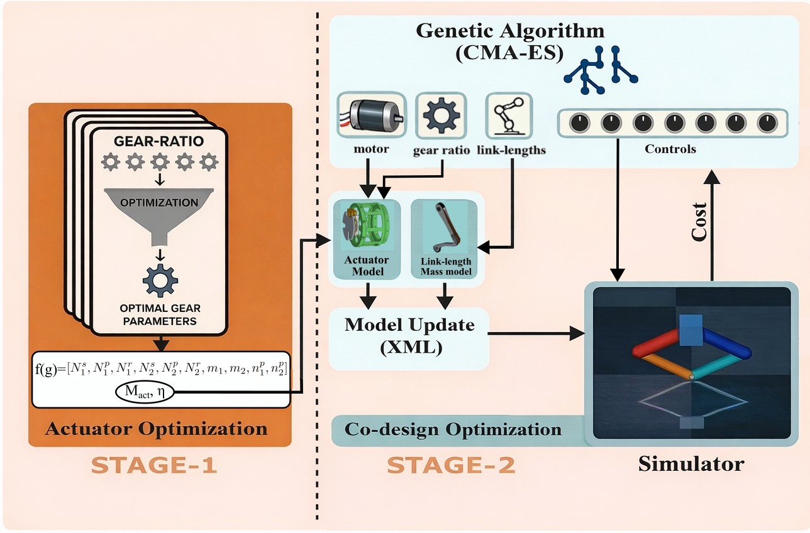
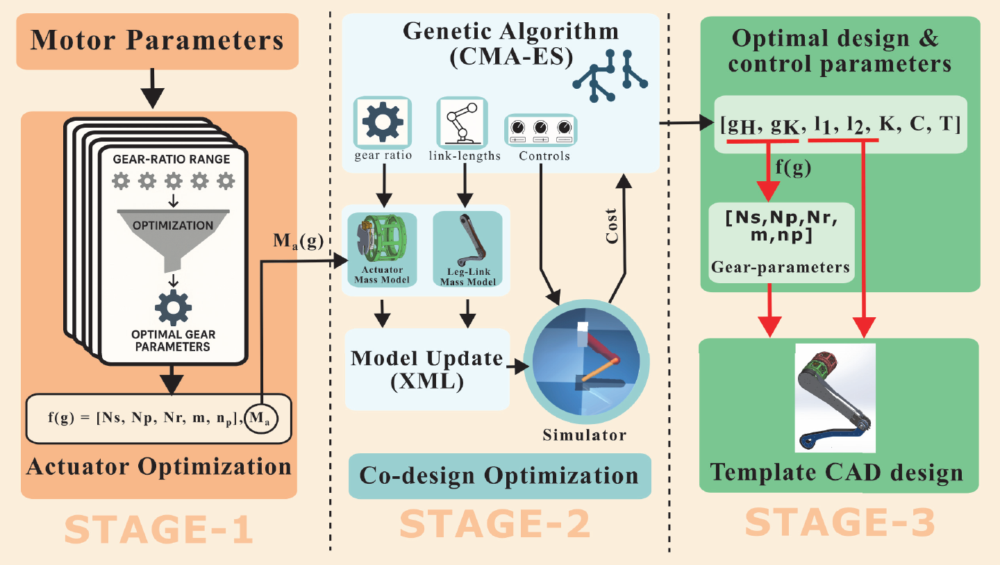

 

### Introduction

A robot's performance depends on both its body and its controller, so we treat them as one coupled design problem. Our co-design work optimizes mechanical parameters such as link lengths, actuator and gearbox parameters, and control parameters at the same time, using dynamic tasks such as jumping to measure performance.

 

### A Co-Design Framework for High-Performance Jumping of a Five-Bar Monoped with Actuator Optimization

Most co-design studies of legged robots optimize link dimensions and transmission ratios but leave out detailed motor and gearbox optimization, and most consider only serial open-chain mechanisms. We propose a two-stage co-design framework for a planar, closed-chain five-bar monoped that jointly optimizes its mechanical design, motor and gearbox parameters, and control parameters for dynamic jumping, maximizing jump distance while minimizing mechanical energy. An actuator optimization step maps gear ratio to actuator mass, efficiency, and peak torque, and this mapping feeds a CMA-ES co-design optimization. In simulation, the optimized design jumps about 30.4% farther than a nominal design and uses 11.5% less mechanical energy. Published at IEEE/ASME AIM 2026. [Paper](https://arxiv.org/abs/2604.06025)

<figure style="text-align: center; margin: 0 auto 1rem; max-width: 860px;">
  
  <figcaption>The two-stage framework: actuator optimization maps gear ratio to actuator mass and efficiency, which feeds CMA-ES co-design of the motor, gear ratio, link lengths, and controls in simulation.</figcaption>
</figure>

 

### A Co-Design Framework for Energy-Aware Monoped Jumping with Detailed Actuator Modeling

Existing co-design frameworks usually optimize either for maximum jump height or for minimum energy, leave out gearbox design, and rely on simplified actuator mass models. We propose a three-stage framework for a 2-DOF monoped with a chain-driven knee and sandwich-style legs that maximizes jump height while minimizing mechanical energy. Stage 1 optimizes the gearbox for each gear ratio, choosing between internal (ISSPG) and external (ESSPG) single-stage planetary gearboxes and their teeth counts, module, and number of planets, with a detailed mass model that includes the motor, gears, bearings, carrier, casing, and backplate. Stage 2 uses CMA-ES in MuJoCo to jointly optimize the hip and knee gear ratios, link lengths, and controller parameters, and Stage 3 automatically generates a parametric CAD model of the optimized leg and actuators. In simulation, the co-designed monoped uses 51% less mechanical energy per jump than the nominal design (15.36 J vs. 31.44 J) while still jumping 0.8 m. Published at IEEE-RAS Humanoids 2025, Seoul, Korea. [Paper](https://ieeexplore.ieee.org/abstract/document/11203144)

<figure style="text-align: center; margin: 0 auto 1rem; max-width: 900px;">
  
  <figcaption>The three-stage framework: actuator optimization, co-design optimization with CMA-ES in simulation, and template CAD generation.</figcaption>
</figure>

 

### Co-Design of Link Lengths and Control for High Vertical Jumping in a Monoped

Joint optimization of a monoped's link lengths and its controller for high vertical jumps. Published at AIR 2025.
