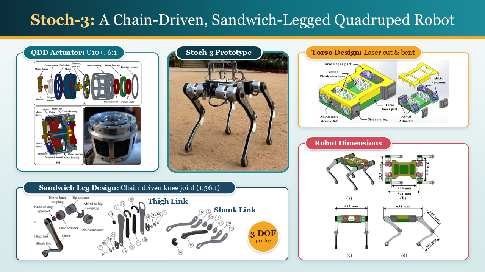
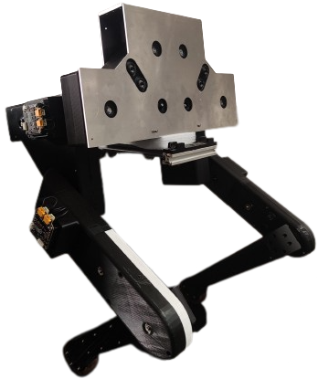
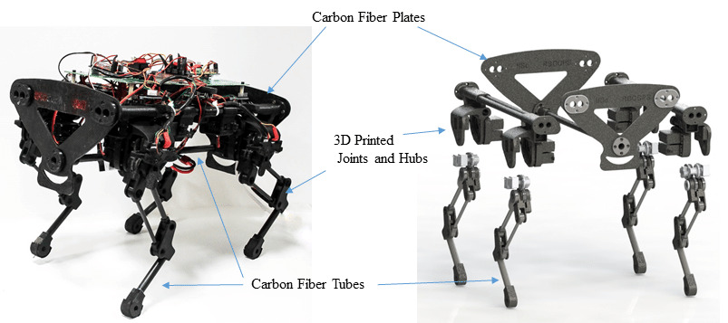

 

### Introduction

Our research on locomotion and control is tested on robots that we design and build in the lab. Our goal is to make capable legged platforms that are affordable, reliable, and easy to manufacture and repair, using laser-cut parts, 3D printing, and quasi-direct-drive actuators. These platforms let us move new controllers quickly from simulation to hardware.

 

### A Chain-Driven, Sandwich-Legged Quadruped Robot

A mid-size quadruped built as an accessible research platform, with a focus on locomotion, actuation reliability and safety, and low-cost manufacturing. A sandwiched leg architecture and a dual-motor configuration reduce leg inertia, while cable strain reliefs, motor heat sinks, and mechanical leg-motion limits improve reliability. The robot uses quasi-direct-drive actuators, is built with laser cutting and 3D printing, weighs 25 kg, and costs under $8000. Experiments show trot and crawl gaits on flat ground and slopes, and the mechanical designs are open-source. The sandwiched leg design is also the subject of an Indian patent. [Paper](https://arxiv.org/abs/2503.14255)

  

 

### Stoch BiRo: A Low-Cost Bipedal Robot

Stoch BiRo is a low-cost bipedal robot with a modular mechanical structure and point feet for uneven terrain. It uses proprioceptive actuation at the abduction, hip, and knee joints, with a Raspberry Pi 4 for control. A learning-based linear policy handles balance and locomotion with only 3 degrees of freedom per leg, without external sensors or prior knowledge of the terrain. [Paper](https://arxiv.org/abs/2312.06512) · [Project page](/projects/StochBiRo.html)

  

 

### Stoch: A Quadrupedal Research Platform

Stoch, our first custom quadruped, was designed as a robust, modular, and reliable platform for exploring locomotion behaviors with both traditional and learning-based methods. [Project page](/projects/stochdesign.html)

  

 

### Dynamic Manipulator

We have also developed a highly dynamic, torque-controllable robotic arm for quadruped robots, with custom planetary gearboxes. [Project page](/projects/DynamicManipulator.html)
